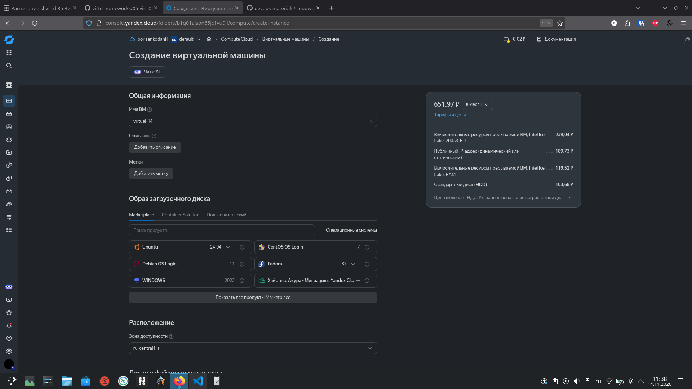
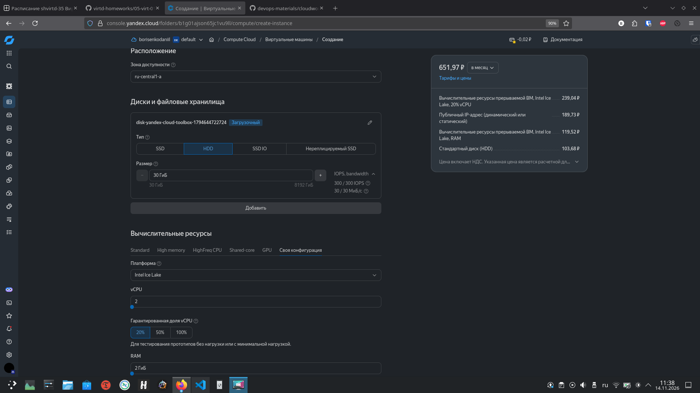
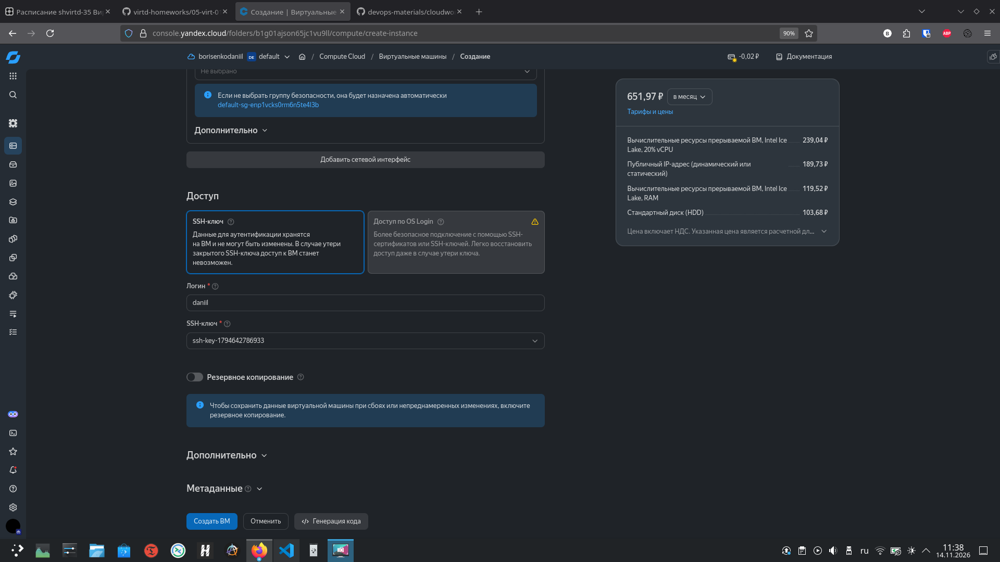
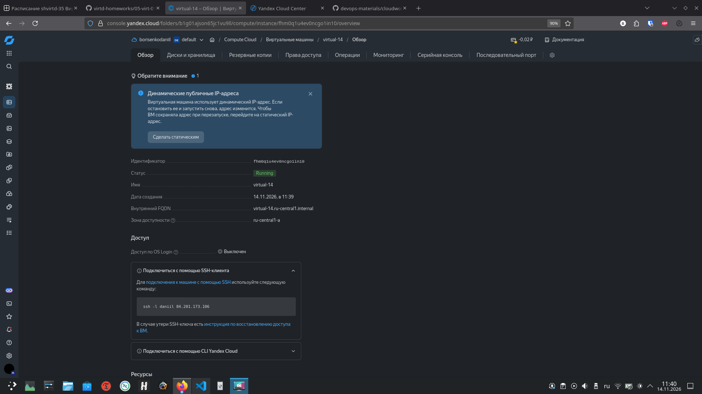
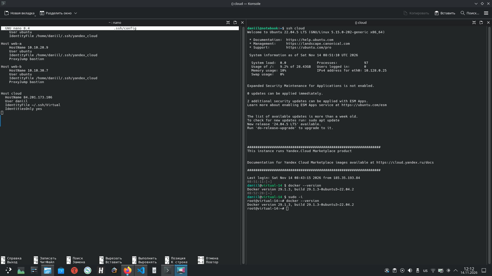

# Домашнее задание к занятию 14.01  «Введение в виртуализацию» - "Борисенко Даниил"

### Цели задания

1. Научиться запускать виртуальную машину в Yandex Cloud с минимальным расходом ресурсов.
2. Попрактиковаться в выборе платформы  и системы управления виртуализации для решения требуемых задач.

## Задача 1

### Условие

Ознакомьтесь с [инструкцией](https://github.com/netology-code/devops-materials/blob/master/cloudwork.MD) по экономии облачных ресурсов.

1. Создайте через web-интерфейс Yandex Cloud - VPC и виртуальную машину из инструкции конфигурации "эконом-ВМ" с публичным ip-адресом. В пункте "Выбор образа/загрузочного диска" выберите вкладку "Cloud Marketplace" , щелкните "Посмотреть больше", найдите образ "Yandex Cloud Toolbox".
2. Убедитесь, что вы можете подключиться к консоли ВМ через ssh, используя публичный ip-адрес. Убедитесь, что на ВМ установлен Docker с помощью команды ```docker --version```(команду выполните от имени root пользователя) !
3. Узнайте в инструкции Яндекс, какие еще инструменты предустановлены в данном образе.
4. Оставьте ВМ работать, пока она не выключится самостоятельно! Опция "прерываемая" выключит ее не позже чем через 24 часа. 
5. Для наглядности подождите еще 1 сутки.
6. Перейдите по [ссылке ](https://console.cloud.yandex.ru/billing?section=accounts). Выберите свой платежный аккаунт. Перейдите на вкладку детализация (фильтр "По продуктам") и оцените график потребления финансов.
7. Удалите ВМ или пользуйтесь ею при выполнении последующих домашних заданий курса обучения.

### Ход решения

ВМ создал в веб-интерфейсе Yandex Cloud: сеть `default`, зона `ru-central1-a`, образ из Cloud Marketplace — Yandex Cloud Toolbox на Ubuntu 22.04, платформа Intel Ice Lake, 2 vCPU с гарантированной долей 20%, 2 ГиБ RAM, диск HDD 30 ГиБ, прерываемая, публичный IP 84.201.173.106. Резервное копирование отключил. Конфигуратор насчитал 651,97 ₽ в месяц. Диск 30 ГиБ вместо 8 из инструкции — меньше консоль не даёт, это минимум для образа Toolbox.









Для подключения дописал в `~/.ssh/config` хост `cloud` и заходил командой `ssh cloud`. Docker проверил от root:

```text
root@virtual-14:~# docker --version
Docker version 29.1.3, build 29.1.3-0ubuntu3~22.04.2
```



Помимо Docker в образе предустановлены Terraform, Yandex Cloud CLI, AWS CLI, Helm, kubectl, Pulumi, Packer, git, gRPCurl, jq, yq, tree и tmux.

ВМ прерываемая, поэтому остановится сама не позже чем через сутки. После этого удалю её вместе с загрузочным диском.

---

## Задача 2

### Условие

Выберите один из вариантов платформы в зависимости от задачи. Здесь нет однозначно верного ответа так как все зависит от конкретных условий: финансирование, компетенции специалистов, удобство использования, надежность, требования ИБ и законодательства, фазы луны.

Тип платформы:

- физические сервера;
- паравиртуализация;
- виртуализация уровня ОС;

Задачи:

- высоконагруженная база данных MySql, критичная к отказу;
- различные web-приложения;
- Windows-системы для использования бухгалтерским отделом;
- системы, выполняющие высокопроизводительные расчёты на GPU.

Объясните критерии выбора платформы в каждом случае.

### Ход решения

Смотрел на конкретную задачу, а не на то, что моднее. По пунктам получилось так.

1. MySQL под высокой нагрузкой, критичная к отказу. Взял бы физические серверы: база такого уровня очень чувствительна к диску, а любой гипервизор добавляет на ввод-вывод свою задержку. Отказоустойчивость всё равно придётся делать репликацией и кластером, поэтому виртуализация тут ничего не выигрывает, только усложняет.

2. Web-приложения. Тут наоборот: приложений много, ресурсов каждому нужно мало, а выкатывать и откатывать их надо постоянно. Поэтому виртуализация уровня ОС, то есть контейнеры. Они на одном ядре, но изолированы, и лимиты по CPU, RAM и диску ставятся отдельно на каждый, так что на одном сервере уживается много приложений. Минус в том, что контейнеры бывают только под Linux, но для web этого хватает.

3. Windows для бухгалтерии. Паравиртуализация: нужна полноценная машина с отдельной Windows, а контейнеры так не умеют, у них ядро общее и свои патчи туда не поставишь. Заодно на гипервизоре удобно сделать снимок перед обновлением 1С и откатиться, если что-то пошло не так.

4. Расчёты на GPU. Физические серверы. Через виртуализацию карта отдаётся не целиком, часть уходит на слой гипервизора, и для расчётов это лишняя потеря. На своём железе задача забирает всю карту.

Вывод простой: под высокую нагрузку и GPU беру физику, под кучу мелких приложений контейнеры, под Windows гипервизор.

---

## Задача 3

### Условие

Выберите подходящую систему управления виртуализацией для предложенного сценария. Опишите ваш выбор.

Сценарии:

1. 100 виртуальных машин на базе Linux и Windows, общие задачи, нет особых требований. Преимущественно Windows based-инфраструктура, требуется реализация программных балансировщиков нагрузки, репликации данных и автоматизированного механизма создания резервных копий.
2. Требуется наиболее производительное бесплатное open source-решение для виртуализации небольшой (20-30 серверов) инфраструктуры на базе Linux и Windows виртуальных машин.
3. Необходимо бесплатное, максимально совместимое и производительное решение для виртуализации Windows-инфраструктуры.
4. Необходимо рабочее окружение для тестирования программного продукта на нескольких дистрибутивах Linux.


### Ход решения

1. **Hyper-V.** Инфраструктура на Windows, а Hyper-V встроен в Windows Server, где уже есть Live-миграция, реплики Hyper-V и SMB с NTFS, так что репликация и бэкапы делаются штатными средствами.

2. **KVM.** Бесплатный, работает через аппаратную виртуализацию Intel VT и AMD SVM, а гостевая машина идёт как обычный процесс в хосте, поэтому накладные расходы небольшие.

3. **Xen.** Кросс-платформенный и бесплатный, для Windows подходит режим Xen HVM (полная аппаратная виртуализация), продукт зрелый и стабильный.

4. **KVM.** ВМ создаётся из ISO или шаблона со своим ядром, дистрибутивы друг другу не мешают, а снимки позволяют откатиться после теста.

---

## Задача 4

### Условие

Опишите возможные проблемы и недостатки гетерогенной среды виртуализации (использования нескольких систем управления виртуализацией одновременно) и что необходимо сделать для минимизации этих рисков и проблем. Если бы у вас был выбор, создавали бы вы гетерогенную среду или нет?

### Ход решения

Гетерогенная среда — это когда одновременно работают VMware, Hyper-V и KVM, например после покупки компании или когда разные отделы ставили, что умели.

Проблемы тут такие: образы и шаблоны у платформ несовместимы, перенести ВМ между ними просто так не получится; мониторинг, бэкап и автоматизация у каждой свои, а значит их надо настраивать несколько раз; инженерам приходится держать компетенции по всем системам сразу; лицензии и поддержка тоже разные.

Минимизировать это можно общими правилами: единый формат образов и шаблонов, одинаковый бэкап и мониторинг поверх всех платформ, автоматизация через Terraform и Ansible, регламент, какую систему под что использовать.

Я бы гетерогенную среду не создавал. Держал бы одну платформу, а вторую только если уже есть железо или софт, который на первой не работает.

---
