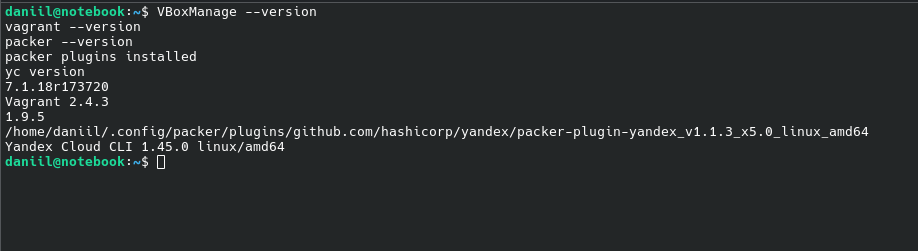
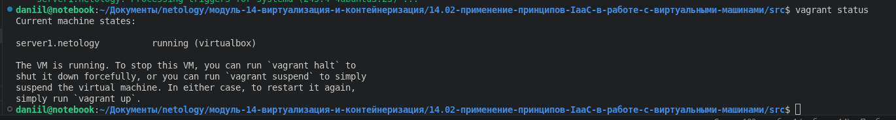
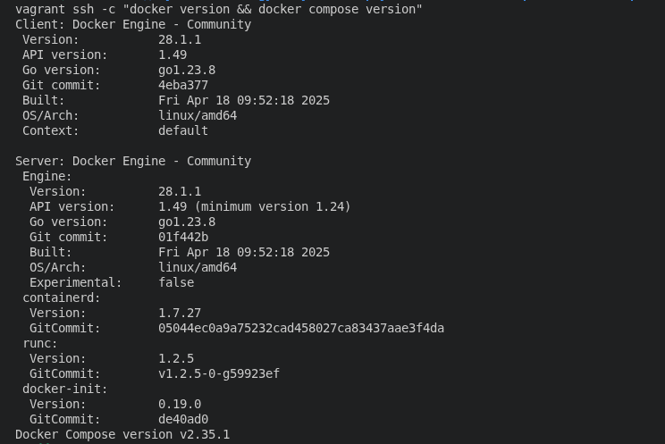
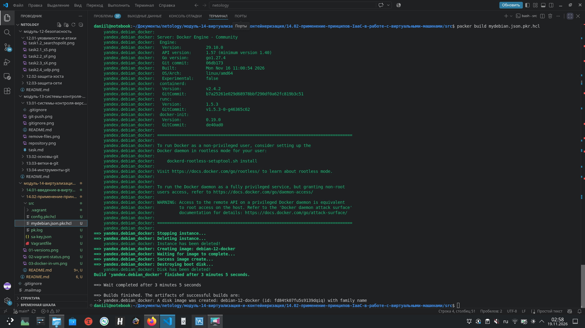
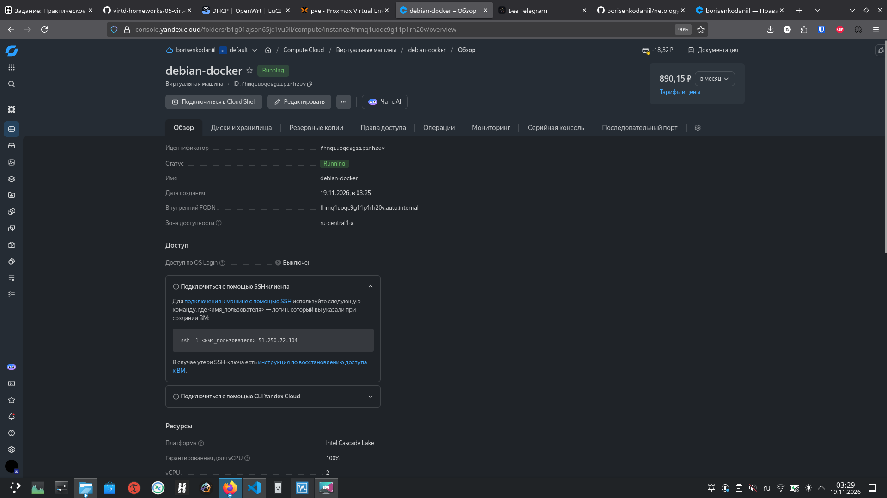
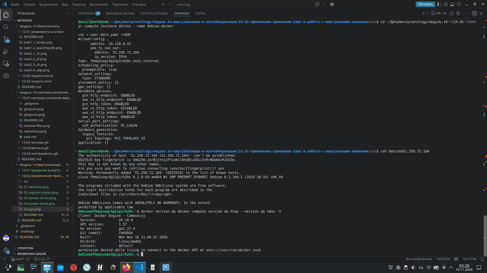
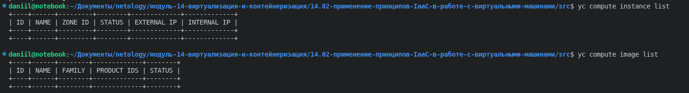

# Домашнее задание к занятию 14.02 «Применение принципов IaaC в работе с виртуальными машинами» - Борисенко Даниил

### Цели задания

1. Научиться создвать виртуальные машины в Virtualbox с помощью Vagrant.
2. Научиться базовому использованию packer в yandex cloud.

## Задача 1

### Условие

Установите на личный Linux-компьютер или учебную **локальную** ВМ с Linux следующие сервисы(желательно ОС ubuntu 20.04):

- [VirtualBox](https://www.virtualbox.org/),
- [Vagrant](https://github.com/netology-code/devops-materials), рекомендуем версию 2.3.4
- [Packer](https://github.com/netology-code/devops-materials/blob/master/README.md) версии 1.9.х + плагин от Яндекс Облако по [инструкции](https://cloud.yandex.ru/docs/tutorials/infrastructure-management/packer-quickstart)
- [уandex cloud cli](https://cloud.yandex.com/ru/docs/cli/quickstart) Так же инициализируйте профиль с помощью ```yc init``` .

Примечание: Облачная ВМ с Linux в данной задаче не подойдёт из-за ограничений облачного провайдера. У вас просто не установится virtualbox.

### Ход решения

Задание выполнялось на ноутбуке с Debian 13.

Пакета VirtualBox в репозитории Debian нет, поэтому подключён репозиторий Oracle:

```bash
wget -O- https://www.virtualbox.org/download/oracle_vbox_2016.asc \
  | sudo gpg --dearmor --yes -o /usr/share/keyrings/oracle-virtualbox-2016.gpg

echo "deb [arch=amd64 signed-by=/usr/share/keyrings/oracle-virtualbox-2016.gpg] \
https://download.virtualbox.org/virtualbox/debian trixie contrib" \
  | sudo tee /etc/apt/sources.list.d/virtualbox.list

sudo apt update
sudo apt install virtualbox-7.2
```

При первом запуске `vagrant up` Vagrant отказался работать с версией 7.2:

```text
Vagrant has detected that you have a version of VirtualBox installed
that is not supported by this version of Vagrant. Please install one of
the supported versions listed below to use Vagrant:

4.0, 4.1, 4.2, 4.3, 5.0, 5.1, 5.2, 6.0, 6.1, 7.0, 7.1
```

В том же репозитории Oracle ветка 7.1 лежит отдельным пакетом, поэтому 7.2 был заменён на 7.1:

```bash
sudo apt purge virtualbox-7.2
sudo apt install virtualbox-7.1
```

Vagrant установлен из официального репозитория HashiCorp, версия 2.4.3:

```bash
apt-cache policy vagrant
vagrant --version
```

```text
Установлен: 2.4.3-1
Vagrant 2.4.3
```

Packer 1.9.5:

```bash
wget https://releases.hashicorp.com/packer/1.9.5/packer_1.9.5_linux_amd64.zip
sudo apt install -y unzip
unzip packer_1.9.5_linux_amd64.zip
sudo mv packer /usr/local/bin/
```

Файл `config.pkr.hcl`:

```hcl
packer {
  required_plugins {
    yandex = {
      version = ">= 1.1.2"
      source  = "github.com/hashicorp/yandex"
    }
  }
}
```

Плагин установлен командой:

```bash
packer init config.pkr.hcl
```

Yandex Cloud CLI и профиль:

```bash
curl -sSL https://storage.yandexcloud.net/yandexcloud-yc/install.sh | bash
exec -l $SHELL
yc init
```

Проверка версий:

```bash
VBoxManage --version
vagrant --version
packer --version
packer plugins installed
yc version
```

Результат:

```text
7.1.18r173720
Vagrant 2.4.3
1.9.5
/home/daniil/.config/packer/plugins/github.com/hashicorp/yandex/packer-plugin-yandex_v1.1.3_x5.0_linux_amd64
Yandex Cloud CLI 1.45.0 linux/amd64

```



## Задача 2

### Условие

1. Убедитесь, что у вас есть ssh ключ в ОС или создайте его с помощью команды ```ssh-keygen -t ed25519```
2. Создайте виртуальную машину Virtualbox с помощью Vagrant и  [Vagrantfile](https://github.com/netology-code/virtd-homeworks/blob/shvirtd-1/05-virt-02-iaac/src/Vagrantfile) в директории src.
3. Зайдите внутрь ВМ и убедитесь, что Docker установлен с помощью команды:

```bash
docker version && docker compose version
```

3. Если Vagrant выдаёт ошибку (блокировка трафика):

```
URL: ["https://vagrantcloud.com/bento/ubuntu-20.04"]     
Error: The requested URL returned error: 404:
```

Выполните следующие действия:

- Используйте [зеркало](https://vagrant.elab.pro/downloads/) файл-образ "bento/ubuntu-24.04".

**Важно:**    

- Если ваша хостовая рабочая станция - это windows ОС, то у вас могут возникнуть проблемы со вложенной виртуализацией. Ознакомиться со cпособами решения можно [по ссылке](https://www.comss.ru/page.php?id=7726).

- Если вы устанавливали hyper-v или docker desktop, то  все равно может возникать ошибка:  
`Stderr: VBoxManage: error: AMD-V VT-X is not available (VERR_SVM_NO_SVM)`   
 Попробуйте в этом случае выполнить в Windows от администратора команду `bcdedit /set hypervisorlaunchtype off` и перезагрузиться.

- Если ваша рабочая станция в меру различных факторов не может запустить вложенную виртуализацию - допускается неполное выполнение(до ошибки запуска ВМ)

### Ход решения

SSH-ключ:

```bash
ssh-keygen -t ed25519
cat ~/.ssh/id_ed25519.pub
```

В каталог `src` скопирован Vagrantfile из репозитория курса. В нём одна машина `server1.netology` на образе `bento/ubuntu-20.04`, адрес 192.168.56.11, ssh проброшен на 20011, при старте выполняется провижн с установкой Docker.

```bash
vagrant up --provider=virtualbox
```

Провижн установил Docker из репозитория Docker:

```text
server1.netology: Setting up docker-ce (5:28.1.1-1~ubuntu.20.04~focal) ...
server1.netology: Setting up containerd.io (1.7.27-1) ...
server1.netology: Setting up docker-compose-plugin (2.35.1-1~ubuntu.20.04~focal) ...
```

Статус машины:

```bash
vagrant status
```



Пользователь `vagrant` добавлен в группу `docker`, иначе `docker version` возвращает `permission denied` на `/var/run/docker.sock`:

```bash
sudo usermod -aG docker vagrant
```

Проверка Docker внутри ВМ:

```bash
vagrant ssh -c "docker version && docker compose version"
```

Результат:

```text
Client: Docker Engine - Community
 Version:           28.1.1
 API version:       1.49
 Go version:        go1.23.8
 Git commit:        4eba377
 Built:             Fri Apr 18 09:52:18 2025
 OS/Arch:           linux/amd64
 Context:           default

Server: Docker Engine - Community
 Engine:
  Version:          28.1.1
  API version:      1.49 (minimum version 1.24)
  Go version:       go1.23.8
  Git commit:       01f442b
  Built:            Fri Apr 18 09:52:18 2025
  OS/Arch:          linux/amd64
  Experimental:     false
 containerd:
  Version:          1.7.27
  GitCommit:        05044ec0a9a75232cad458027ca83437aae3f4da
 runc:
  Version:          1.2.5
  GitCommit:        v1.2.5-0-g59923ef
 docker-init:
  Version:          0.19.0
  GitCommit:        de40ad0
Docker Compose version v2.35.1
```



## Задача 3

### Условие

1. Отредактируйте файл    [mydebian.json.pkr.hcl](https://github.com/netology-code/virtd-homeworks/blob/shvirtd-1/05-virt-02-iaac/src/mydebian.json.pkr.hcl)  или [mydebian.jsonl](https://github.com/netology-code/virtd-homeworks/blob/shvirtd-1/05-virt-02-iaac/src/mydebian.json) в директории src (packer умеет и в json, и в hcl форматы):
   - добавьте в скрипт установку docker. Возьмите скрипт установки для debian из  [документации](https://docs.docker.com/engine/install/debian/)  к docker, 
   - дополнительно установите в данном образе htop и tmux.(не забудьте про ключ автоматического подтверждения установки для apt)
3. Найдите свой образ в web консоли yandex_cloud
4. Необязательное задание(*): найдите в документации yandex cloud как найти свой образ с помощью утилиты командной строки "yc cli".
5. Создайте новую ВМ (минимальные параметры) в облаке, используя данный образ.
6. Подключитесь по ssh и убедитесь в наличии установленного docker.
7. Удалите ВМ и образ.
8. **ВНИМАНИЕ!** Никогда не выкладываете oauth token от облака в git-репозиторий! Утечка секретного токена может привести к финансовым потерям. После выполнения задания обязательно удалите секретные данные из файла mydebian.json и mydebian.json.pkr.hcl. (замените содержимое токена на  "ххххх")
9. В качестве ответа на задание  загрузите результирующий файл в ваш ЛК.

### Ход решения

Оставлен HCL-вариант файла. Авторизация сделана через ключ сервисного аккаунта, поэтому OAuth-токен в файле не нужен и в репозиторий не попадает.

```bash
yc iam key create --service-account-name vm --output sa-key.json
```

Файл `mydebian.json.pkr.hcl`:

```hcl
source "yandex" "debian_docker" {
  disk_type                = "network-ssd"
  folder_id                = "b1g01ajson65jc1vu9ll"
  image_description        = "my custom debian with docker"
  image_name               = "debian-12-docker"
  service_account_key_file = "sa-key.json"
  source_image_family      = "debian-12"
  ssh_timeout              = "10m"
  ssh_username             = "debian"
  subnet_id                = "e9bhgsn7vsbpg1fjipsm"
  use_ipv4_nat             = true
  zone                     = "ru-central1-a"
}

build {
  sources = ["source.yandex.debian_docker"]

  provisioner "shell" {
    execute_command = "sudo -E bash '{{.Path}}'"

    inline = [
      "export DEBIAN_FRONTEND=noninteractive",
      "apt-get update",
      "apt-get install -y ca-certificates curl htop tmux",
      "curl -fsSL https://get.docker.com -o /tmp/get-docker.sh",
      "sh /tmp/get-docker.sh",
      "systemctl enable docker"
    ]
  }
}
```

Образ собран из `debian-12`: в документации Docker поддерживаются Debian 12 и 13, а `debian-11` уже вне поддержки. Диск выбран SSD, так как квота дисков `network-hdd` в зоне `ru-central1-a` была исчерпана.

```bash
packer build mydebian.json.pkr.hcl
```

```text
==> yandex.debian_docker: Creating image: debian-12-docker
==> yandex.debian_docker: Success image create...
Build 'yandex.debian_docker' finished after 3 minutes 5 seconds.

==> Builds finished. The artifacts of successful builds are:
--> yandex.debian_docker: A disk image was created: debian-12-docker (id: fd84tk07fu5s9139dqiq)
```



Образ через `yc cli`:

```bash
yc compute image list
yc compute image get --name debian-12-docker
```



ВМ из образа, минимальные параметры (2 vCPU, 2 ГБ, прерываемая):

```bash
cat > user-data.yaml <<EOF
#cloud-config
ssh_authorized_keys:
  - $(cat ~/.ssh/id_ed25519.pub)
EOF

yc compute instance create --name debian-docker \
  --zone ru-central1-a \
  --network-interface subnet-name=default-ru-central1-a,nat-ip-version=ipv4 \
  --create-boot-disk image-id=fd84tk07fu5s9139dqiq,size=10 \
  --cores 2 --memory 2G --preemptible \
  --metadata enable-oslogin=false \
  --metadata-from-file user-data=user-data.yaml
```

Ключ передан через `user-data`, потому что в каталоге включён OS Login и ключи из метадаты не применяются.

```bash
ssh debian@51.250.72.104
docker version && docker compose version && htop --version && tmux -V
```

```text
Client: Docker Engine - Community
 Version:           29.10.0
 API version:       1.57
 Go version:        go1.27.4
 OS/Arch:           linux/amd64
permission denied while trying to connect to the docker API at unix:///var/run/docker.sock
```

Docker в образе установлен, клиент версии 29.10.0. Демон обычному пользователю недоступен, пока его не добавили в группу `docker`, поэтому версия демона и compose проверяются от root: `sudo docker version && sudo docker compose version`. Пакеты `htop` и `tmux` ставились в том же провижне.



Удаление ВМ и образа:

```bash
yc compute instance delete --name debian-docker
yc compute image delete --name debian-12-docker
```

